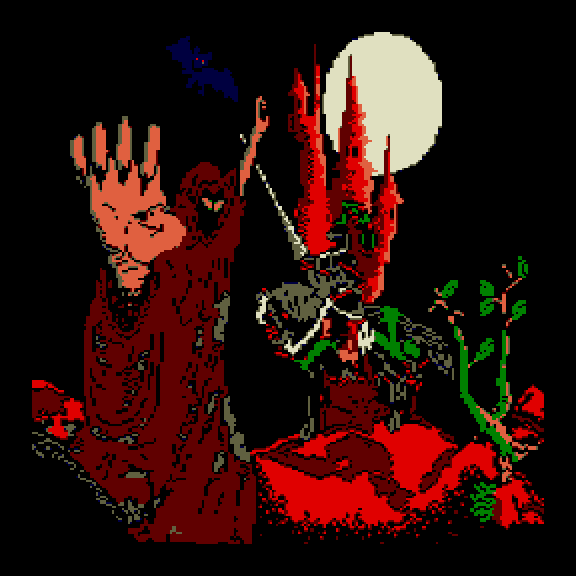
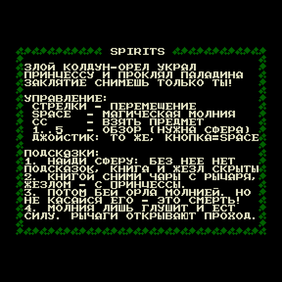
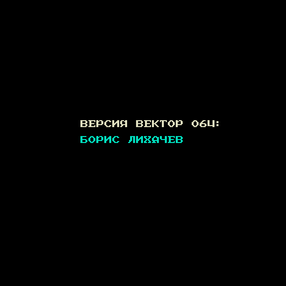
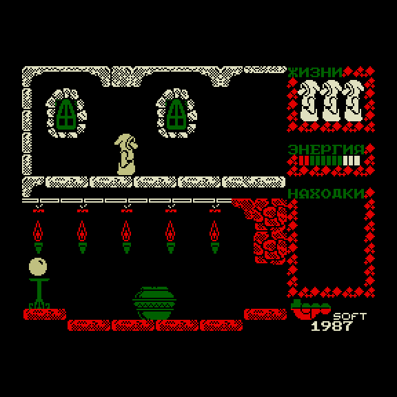
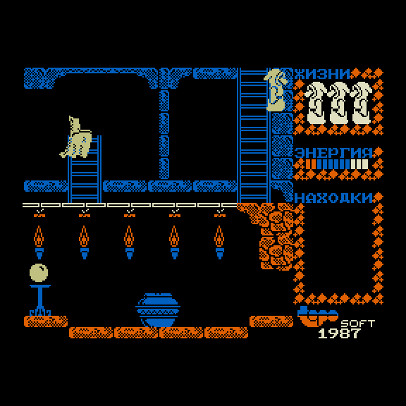
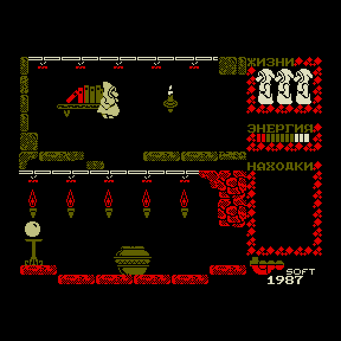

# Spirits — порт на Вектор-06Ц

Игра [Spirits](https://www.generation-msx.nl/software/topo-soft/spirits/2314)
(Topo Soft / Erbe, 1987, MSX) на ванильном **Векторе-06Ц** (КР580ВМ80А /
i8080). Без Z80-переходника.

| Заставка | Справка | Титры |
|---|---|---|
|  |  |  |

| Начало игры | Комната 09 | Комната 05 |
|---|---|---|
|  |  |  |

## Готовый образ

[`rom/spirits.rom`](rom/spirits.rom) — полный порт для i8080 с заставкой, справкой и
читами, 65280 байт (вторая половина файла — картинка заставки прямо в видеопамять).
Для MiSTer (ядро Vector-06C) и эмуляторов Вектора.

## Управление

Стрелки — ход, пробел — магическая молния, СС — взять предмет, 1–5 — обзор
(нужна сфера), ВК — пауза. Джойстик: штатный (порт 0Eh) или «П» (ППИ2, порт 06h),
оба читаются с фильтром мусора на шине; кнопка — как пробел.

**Читы** ([docs/cheats.md](docs/cheats.md)): на титрах зажать **F1+F3** — партия
начнётся сразу в режиме читов. Тогда **G** включает и выключает режим бога
(энергия не убывает, мгновенная смерть не срабатывает), **8/9/6/7** — перейти в
комнату сверху/снизу/слева/справа, **K** — в комнату нижнего окна. Без F1+F3 эти
клавиши не делают ничего.

Этот репозиторий — **только сборка порта**: исходники адаптера, дизасм
MSX с комментариями, рекомпилятор Z80→i8080 и скрипты, которые собирают
ROM. Исследовательские журналы, стенды сверки с MSX и прочие порты сюда
не входят.

## Что внутри

```
disasm/msx/orig/   дизасм оригинала MSX (с комментариями)
disasm/msx/        канон +0x100
disasm/msx/v06/    раскладка Вектора (вход рекомпилятора)
src/v06/           адаптер экрана, ввода, звука, заставка, читы
src/i8080/         рекомпилированный код игры + runtime-хелперы
ref/msx/           payload кассеты
ref/title/         картинка заставки (исходник для mk_title)
build/v06/         блоки игры (можно пересобрать)
build/title/       плоскости заставки
build/analysis/    профиль горячих IX/IY для рекомпилятора
tools/             сборка и рекомпиляция
docs/              геймплей, читы, справка, рекомпиляция
```

## Зависимости

- Python 3
- **[zasm](https://k1.spdns.de/Develop/Projects/zasm/) 4.5** с ключом `--8080`
- для стендов — Node.js и клон [vector06js](https://github.com/svofski/vector06js)
  в `~/projects/vector06js` (или путь в `V06`)

Путь к ассемблеру — переменная `ZASM` (`tools/build_all.sh` без неё берёт `zasm`
из PATH):

```sh
export ZASM=/path/to/zasm
```

## Сборка

Одной командой — образ в `build/port/spirits-port-i8080.rom` и копия в `rom/spirits.rom`:

```sh
sh tools/build_all.sh
```

Те же шаги по отдельности, из корня:

```sh
sh tools/build_adapter.sh
python3 tools/build_v06_rom.py              # эталон Z80 (нужен рекомпилятору)
python3 tools/recompile_i8080.py            # → src/i8080/game.asm
python3 tools/build_v06_rom.py  --cpu i8080
python3 tools/build_port_rom.py --cpu i8080 # → build/port/spirits-port-i8080.rom
```

Плоскости заставки уже в `build/title/`. Пересобрать картинку
(нужен Pillow): `python3 tools/mk_title.py`.

Пересобрать блоки игры из дизасма: `python3 tools/verify_v06.py --write`.

Подробности метода — [`docs/recompilation.md`](docs/recompilation.md).

## Проверки

```sh
node tools/cheat_probe_v06js.js                       # читы: 35 проверок + кадры
python3 tools/adapter_probe.py build/v06/adapter.bin build/v06/adapter.lst   # адаптер ввода/звука, модель 8080
node tools/trap_stale_v06js.js build/port/spirits-port-i8080.rom 3000          # 3000 кадров без срыва
```

## Документация

| файл | о чём |
|------|--------|
| [docs/gameplay.md](docs/gameplay.md) | как играть |
| [docs/cheats.md](docs/cheats.md) | чит-коды и их стенды |
| [docs/JOY_REPORT.md](docs/JOY_REPORT.md) | чтение джойстиков (0Eh и «П») |
| [docs/help-page-ru.md](docs/help-page-ru.md) | текст справки в ROM |
| [docs/v06-input-sound.md](docs/v06-input-sound.md) | клавиатура и звук |
| [docs/recompilation.md](docs/recompilation.md) | Z80 → i8080 |
| [docs/known-issues.md](docs/known-issues.md) | известные отличия |
| [docs/RESOURCES.md](docs/RESOURCES.md) | откуда бинарники |

## Лицензия

Код порта и инструментов — см. [LICENSE](LICENSE). Оригинальная игра
Spirits принадлежит правообладателям Topo Soft / Erbe; см. [NOTICE](NOTICE).
